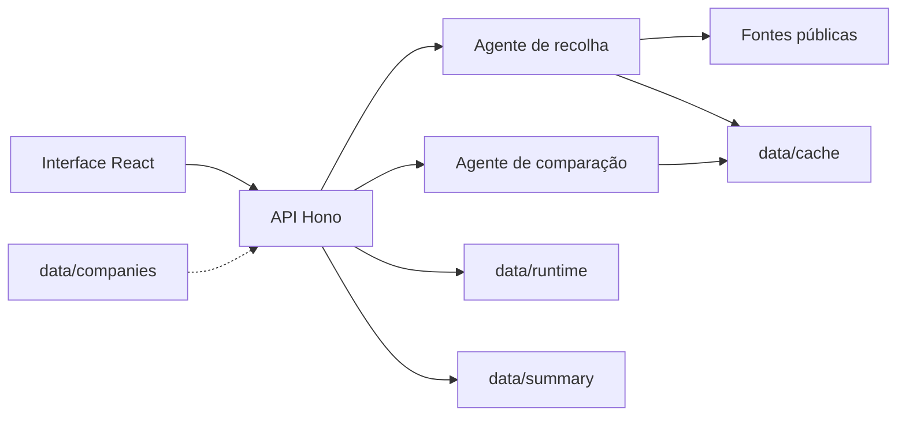

# Data Integrity Agent

Protótipo para o Laboratório de IA e Transformação Digital SpaceXAI (Forum Braga, 26 e 27 de outubro de 2026), organizado pelo IAPMEI. Mantém 31 empresas portuguesas em ficheiros JSON e confronta quatro campos de cada uma com fontes públicas: morada da sede, CAE principal, website e estado jurídico.

Duas peças de Grok fazem a verificação. Uma pessoa aprova ou rejeita cada proposta. Só a aprovação altera a empresa.

## Stack

| Peça | Escolha | Razão |
| --- | --- | --- |
| HTTP | Hono 4 em Node.js 24 | Sem passo de build; o TypeScript corre pelo tsx. |
| Contrato | Zod 4 e OpenAPI | O mesmo esquema valida o pedido e documenta a rota. |
| Documentação | Swagger UI em `/api/docs` | Dá para experimentar a API sem a interface. |
| Agentes | Vercel AI SDK e Grok | Dois agentes com ferramentas, modelos separados. |
| Páginas | Cheerio | Ler o HTML das fontes. |
| Pesquisa web | Tavily | Restringir LinkedIn, redes sociais e Teamlyzer a domínios. |
| Interface | React e Vite | A API serve `app/dist` quando o `index.html` existe. |
| Testes | Vitest | Pastas temporárias, sem chaves e sem internet. |
| Dados | JSON | Quatro ficheiros de trabalho mais o resumo das propostas. |



A seta a tracejado é só leitura: a referência não é escrita.

## Como correr

Na pasta `api/`:

```bash
npm install
cp .env.example .env
npm run dev
```

A API fica em http://localhost:3000/api e o Swagger em http://localhost:3000/api/docs. O detalhe dos comandos, dos ficheiros e das variáveis está em `api/README.md`.

`npm run db:reset` repõe a cópia de trabalho. `npm run db:seed` deixa três propostas de exemplo para aprovar e rejeitar antes de os agentes existirem. Nenhum dos dois consulta a internet. Não os correr por cima de `data/summary/summary.json` se esse ficheiro tiver o histórico real.

## Ligar os agentes

| Chave ou variável | Para quê | Sem ela |
| --- | --- | --- |
| `XAI_API_KEY` | Os dois agentes | Verificação e ronda semanal em 501 |
| `GROK_MODEL_RECOLHA` | Modelo da recolha | `grok-4.7` |
| `GROK_MODEL_COMPARACAO` | Modelo da comparação | `grok-4.7` |
| `GOOGLE_MAPS_API_KEY` | Morada, website e estado no Google Maps | A fonte não é usada |
| `TAVILY_API_KEY` | Pesquisa web | A fonte não é usada |
| `MODO_OFFLINE=1` | Repetir `data/cache/` | Os agentes consultam as fontes |
| `AGENT_MAX_STEPS` | Teto de passos da recolha, de 4 a 40 | 16 |

`GET /agentes` diz se estão ligados, com que modelos e com que ferramentas.

## Verificação semanal

Liga-se na página das empresas, ou com `PUT /api/verificacao-semanal` e `{ "enabled": true }`. A primeira ronda começa logo. A seguinte fica marcada para a mesma hora local de Lisboa, sete dias depois, incluindo a mudança de hora.

Cada empresa é verificada uma de cada vez, com a mesma verificação do botão, e cada uma gasta tokens. Desligar deixa acabar a empresa em curso e marca a ronda como interrompida. Uma falha fica registada e a ronda segue. Uma empresa que o botão já esteja a verificar é saltada. Se o processo cair a meio, a ronda guardada em `data/runtime/schedule.json` retoma nas empresas que faltam.

## Os dois agentes

| | Recolha | Comparação |
| --- | --- | --- |
| Skill | `browse-data` | `compare-data` |
| Entrada | A empresa guardada | A empresa e a evidência recolhida |
| Saída | Evidência literal e pesquisas | Uma decisão por campo |
| Decisões | — | `manter`, `propor`, `ignorar`, `rever` |
| O que a API faz com a saída | Substitui a evidência e as pesquisas dessa empresa | Cria propostas só para `propor` e `rever` |

### Recolha

Percorre as fontes de cada campo pela ordem de prioridade. Cada fonte acaba em `encontrado`, `nada` ou `falhou`, com o URL e uma nota quando os houver. A evidência traz o valor tal como a fonte o escreve, o URL e o excerto. Não decide se o valor guardado muda.

### Comparação

Escolhe, por campo, manter o valor, propor outro, ignorar a evidência ou mandar o caso a uma pessoa. As regras fixas da skill aplicam-se depois da resposta do modelo e ganham sempre:

1. Sem evidência, ou com evidência igual ao valor guardado depois de normalizar, fica `manter`.
2. Um valor proposto igual ao guardado passa a `manter`.
3. Um valor inválido para o campo (CAE sem 5 dígitos, estado fora da lista) passa a `rever`, sem valor novo.
4. `propor` precisa da fonte de maior prioridade do campo, ou de duas fontes diferentes que concordem. Caso contrário passa a `rever`.
5. No estado, `CLOSED_PERMANENTLY` do Google Maps sozinho nunca dá `propor`.
6. Evidência só de outros sites (`web`) nunca dá `propor`.
7. O URL e o excerto têm de pertencer a uma das evidências.

A normalização ignora maiúsculas, acentos e pontuação. Na morada expande abreviaturas (`Av.` para Avenida, `R.` para Rua, e as restantes da tabela) e trata `n.º` como ruído. Duas moradas são a mesma quando o código postal e os números coincidem, se ambas os tiverem, e todas as palavras da mais curta estão na outra. No website compara-se o domínio, sem protocolo, `www` nem caminho. Na CAE comparam-se os 5 dígitos. No estado, `OPERATIONAL` e «Activa» contam como Ativa.

Uma alteração rejeitada não volta a ser proposta durante 14 dias a contar da verificação, mesmo que a morada venha escrita de outra forma.

## Fontes de cada campo

A ordem é a prioridade: a primeira fonte que a recolha consulta pesa mais na comparação.

- **Morada:** site, Google Maps, Teamlyzer, LinkedIn, Instagram, Facebook, X, Wikipedia, outros sites.
- **CAE:** SICAE, contribuinte.pt, outros sites.
- **Website:** LinkedIn, Instagram, Facebook, X, Google Maps, outros sites.
- **Estado:** Google Maps, outros sites.

| Fonte | Como se lê |
| --- | --- |
| Site da empresa | Abrir a página guardada e as páginas de contactos. |
| Google Maps | Procurar pelo nome e pela localidade (Places API New). |
| Teamlyzer | Pesquisar em teamlyzer.com e, se preciso, abrir o resultado. |
| LinkedIn | Pesquisar em linkedin.com. |
| Instagram | Pesquisar em instagram.com. |
| Facebook | Pesquisar em facebook.com. |
| X | Pesquisar em x.com e twitter.com. |
| Wikipedia | Procurar pelo nome da empresa. |
| SICAE | Consultar sicae.pt pelo NIF. |
| contribuinte.pt | Consultar a página do NIF. |
| Outros sites | Pesquisa sem domínio fixo: só registos oficiais, diretórios conhecidos ou imprensa. Nunca chega para um `propor` sozinha. |

## Endpoints da API

Tudo sob `/api`. O fluxo NDJSON não entra no OpenAPI.

| Método e caminho | O que faz |
| --- | --- |
| `GET /empresas` | Lista as empresas por nome, com o número de propostas pendentes. |
| `GET /empresas/{nif}` | A empresa, a evidência da última verificação, as pesquisas e as propostas. |
| `POST /empresas/{nif}/verificar` | Corre a recolha e a comparação. Responde 201. |
| `POST /empresas/{nif}/verificar/stream` | A mesma verificação em NDJSON, passo a passo. |
| `GET /propostas` | Lista propostas. Por omissão, as pendentes, mais recentes primeiro. |
| `POST /propostas/{id}/aprovar` | Aprova e altera o campo. O corpo é opcional. |
| `POST /propostas/{id}/rejeitar` | Rejeita. O motivo é obrigatório. A empresa não muda. |
| `GET /verificacao-semanal` | Se está ligada, a ronda em curso e a última. |
| `PUT /verificacao-semanal` | Liga ou desliga a ronda. |
| `GET /agentes` | Modelos, ferramentas e se estão ligados. |

Os erros têm a forma `{ "error": { "code", "message", "details?" } }`.

## Formato dos dados

Uma empresa, chaveada pelo NIF de 9 dígitos, que tem de coincidir com o campo `nif`:

| Campo | Conteúdo |
| --- | --- |
| `casualName` | Nome curto, usado na ordenação e nas mensagens. |
| `nif` | Nove dígitos. |
| `name` | Denominação completa. |
| `address` | Morada da sede, ou null. |
| `site` | Website, com ou sem protocolo, ou null. |
| `cae` | Cinco dígitos, ou null. |
| `status` | `Ativa`, `Inativa`, `Em liquidação`, `Insolvente`, `Suspensa`, `Cessada` ou `Dissolvida`. |

Uma proposta em `summary.json` traz, por esta ordem: `id` (`p-001`), `entity`, `entityId`, `field` (`address`, `cae`, `site` ou `status`), `currentValue`, `newValue`, `source`, `extractProof`, `verifiedAt`, `reason`, `status` (`pendente`, `aprovada` ou `rejeitada`), `rejectionReason` e `user`. O ficheiro usa indentação de 4 espaços. Os outros JSON da API usam 2 espaços e terminam com uma mudança de linha.

A evidência guarda `nif`, `field`, `value`, `source`, `url`, `extractProof` e `foundAt`. Cada pesquisa guarda `nif`, `field`, `source`, `outcome` (`encontrado`, `nada` ou `falhou`), `urls`, `note` e `searchedAt`.

## Referências

- IAPMEI, Laboratório de IA e Transformação Digital, Forum Braga, 26 e 27 de outubro de 2026.
- Chave do Grok: https://console.x.ai/
- Tavily: https://app.tavily.com
- SICAE: https://www.sicae.pt
- contribuinte.pt: https://www.contribuinte.pt
- Prioridade das fontes: `.agents/skills/browse-data/references/fontes.json`
- Regras da comparação: `.agents/skills/compare-data/references/regras.md`
- Documentação da API: `api/README.md`
